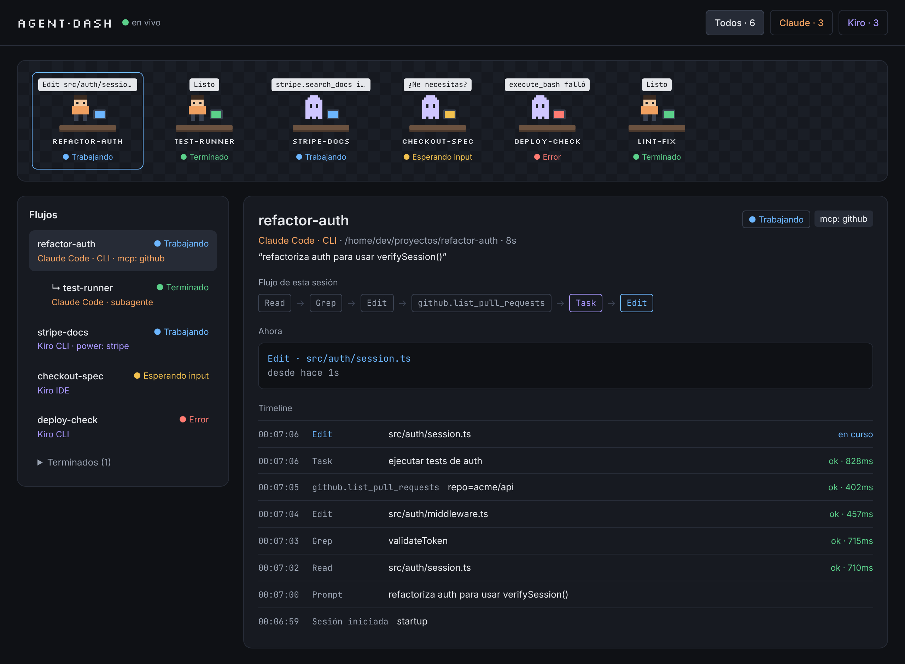

# AgentDash

Dashboard local para **ver en vivo a tus agentes de IA trabajando**, sin importar la plataforma.
La v1 soporta **Claude Code** (CLI y VS Code) y **Kiro** (IDE y CLI): qué agente está activo,
qué herramienta usa ahora mismo, sus subagentes, qué extensiones usa (Powers de Kiro,
MCP y plugins de Claude) y el historial de cada sesión.



- **Oficina pixel**: cada agente en su escritorio. La silueta indica la plataforma (persona = Claude,
  fantasma = Kiro), la burbuja muestra la herramienta actual y el monitor, el estado.
- **Flujos**: agentes y subagentes en árbol, con sus extensiones.
- **Detalle**: cadena de herramientas, qué hace ahora y timeline con duración y resultado.

Inspirado en [Pixel Agents](https://github.com/pablodelucca/pixel-agents) y en
[claude-code-hooks-multi-agent-observability](https://github.com/disler/claude-code-hooks-multi-agent-observability),
pero usa **hooks** (no lee transcripciones), así que el estado es exacto y funciona con varias plataformas.

## Cómo funciona

```
Claude Code / Kiro ──hook──▶ node ~/.agentdash/hook.mjs ──HTTP──▶ servidor (127.0.0.1:4820) ──WebSocket──▶ UI
```

El hook no tiene dependencias, **nunca escribe en stdout** y **siempre sale con 0**:
si el dashboard está apagado, tus agentes funcionan exactamente igual.

## Requisitos

- Node.js **22.13 o superior** (para el servidor y la instalación de hooks).
- Docker (opcional, para levantar el servidor en un contenedor).

## Empezar

```bash
git clone https://github.com/YazterFranco/dashboard-agents.git
```

```bash
cd dashboard-agents && npm install && npm run build
```

Todos los comandos se ejecutan **desde la carpeta del repo** con `npm run agentdash -- <comando>`.
Si prefieres tener el comando `agentdash` disponible en cualquier carpeta, enlázalo una vez:

```bash
npm link -w @agentdash/cli
```

> **No uses `npx agentdash`.** Existe un paquete público en npm con ese nombre que no tiene
> relación con este proyecto: fuera del repo, `npx` lo descargaría y lo ejecutaría.

### 1. Levanta el dashboard

Con Docker:

```bash
docker compose up -d --build
```

O sin Docker:

```bash
npm run agentdash -- start
```

Abre http://127.0.0.1:4820

### 2. Pruébalo con la demo (opcional)

```bash
npm run agentdash -- demo
```

Envía unos 40 s de actividad simulada: una sesión de Claude con un subagente y un MCP,
Kiro CLI usando un Power, Kiro IDE esperando aprobación y una herramienta que falla.

### 3. Conecta tus agentes

**Claude Code** (CLI y extensión de VS Code; nivel usuario):

```bash
npm run agentdash -- install claude
```

**Kiro CLI** (se instala en un agente de `~/.kiro/agents/`; si tienes varios, elige uno):

```bash
npm run agentdash -- install kiro-cli --agent mi-agente
```

**Kiro IDE** (los hooks son por proyecto; pasa la ruta del proyecto con `--workspace`):

```bash
npm run agentdash -- install kiro-ide --workspace /ruta/a/mi-proyecto
```

Abre una sesión nueva del agente y aparecerá en el dashboard en cuanto haga algo.

El instalador:
- copia el hook a `~/.agentdash/hook.mjs`;
- hace una copia `.bak` antes de modificar cualquier archivo;
- se puede ejecutar varias veces sin duplicar nada;
- no toca nada si el JSON existente es inválido.

¿Prefieres pegar los hooks a mano o el formato de tu versión cambió? Usa `--print`:

```bash
npm run agentdash -- install kiro-ide --print
```

## Desinstalar

```bash
npm run agentdash -- uninstall claude
```

Quita solo las entradas de AgentDash (las reconoce porque el comando contiene
`.agentdash/hook.mjs`). La carpeta `~/.agentdash` (hook e historial) se conserva; bórrala a mano si quieres.

## Configuración

| Variable | Por defecto | Para qué |
| --- | --- | --- |
| `AGENTDASH_PORT` | `4820` | Puerto del servidor |
| `AGENTDASH_HOST` | `127.0.0.1` | Interfaz; por defecto solo tu máquina |
| `AGENTDASH_DB` | `~/.agentdash/agentdash.db` | Historial SQLite |
| `AGENTDASH_RETENTION_DAYS` | `7` | Días de historial |
| `AGENTDASH_URL` | `http://127.0.0.1:4820` | A dónde envía el hook |
| `AGENTDASH_DEBUG` | — | `1` para que el hook explique sus errores en stderr |
| `AGENTDASH_ALLOWED_HOSTS` | — | Nombres extra (separados por comas) con los que abrir el dashboard, p. ej. si lo expones en tu red |

## Privacidad

- Todo se queda en tu máquina. El servidor escucha solo en `127.0.0.1`, y en Docker el puerto
  también se publica solo en localhost.
- Solo acepta peticiones cuyo `Host` y `Origin` sean locales (`localhost`, `127.0.0.1`, `::1`):
  una web que visites no puede leer tu actividad por WebSocket ni mediante *DNS rebinding*.
- El hook recorta los textos largos (más de 2000 caracteres) y solo copia dos variables de entorno
  (`TERM_PROGRAM` y `CLAUDE_CODE_ENTRYPOINT`, para distinguir CLI de VS Code).
- Antes de guardar, el servidor redacta patrones de secretos (`sk-…`, `ghp_…`, `AKIA…`, `Bearer …`,
  `password=…`, claves privadas) y limita el payload guardado a 8 KB.

## Estado de la integración con Kiro

Los hooks de Kiro han cambiado entre versiones, así que el adaptador es tolerante:

- **Kiro CLI**: acepta los nombres de eventos v2 (`preToolUse`) y v3 (`PreToolUse`).
- **Kiro IDE**: algunas versiones no envían datos por stdin. El instalador pasa el nombre del
  evento como argumento, así que se sabe qué ocurrió aunque llegue vacío.
- Las herramientas de un **Power** se detectan por su nombre (`@powers/<power>/…` o `<power>___<tool>`).

Si algo aparece como "evento no reconocido", exporta los payloads reales y ábrelos como fixtures:

```bash
npm run agentdash -- export-fixtures --out fixtures --platform kiro
```

Revisa que no contengan datos privados antes de compartirlos.

## Desarrollo

```bash
npm test
```

```bash
npm run typecheck
```

```bash
npm run build && npm run e2e
```

Para la UI en modo desarrollo (con recarga en caliente; necesita el servidor en 4820):

```bash
npm run dev -w @agentdash/web
```

Estructura:

| Paquete | Qué hace |
| --- | --- |
| `packages/shared` | Tipos, esquema del sobre del hook, clasificación de herramientas, redacción |
| `packages/server` | Adaptadores por plataforma, pipeline, estado, SQLite, API HTTP y WebSocket |
| `packages/cli` | Binario `agentdash` (start, install, demo, export-fixtures) y el hook |
| `packages/web` | UI React (oficina, flujos, detalle) |

### Añadir una plataforma

1. Crea `packages/server/src/adapters/<plataforma>.ts` con una función que convierta el
   `HookEnvelope` en `AgentEvent[]` (mira `kiro.ts` como ejemplo).
2. Añade fixtures JSON en `packages/server/test/fixtures/<plataforma>/` y tests en `adapters.test.ts`.
3. Regístrala en `packages/server/src/adapters/index.ts` y en `HookPlatform` (`packages/shared/src/types.ts`).
4. Añade su instalador en `packages/cli/src/install/`.

Diseño y plan: [`docs/superpowers/specs`](docs/superpowers/specs) y [`docs/superpowers/plans`](docs/superpowers/plans).
